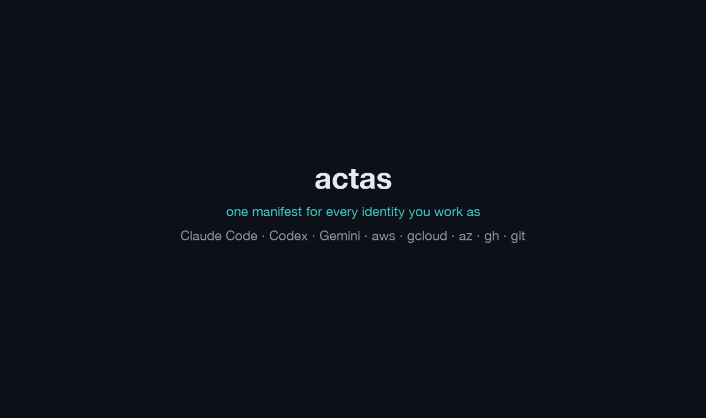

# actas

[](https://github.com/TsenkoTsenkov/actas/actions/workflows/test.yml)
[](LICENSE)


**actas — act as the right identity (LLM provider, cloud accounts, GitHub, git, secrets) for every
project, in every terminal and agent.**

```console
$ actas exec client-a -- terraform apply     # act as client-a for one command
```

You work for several clients, on personal projects and on open source. Each
context has its own LLM provider (a claude.ai subscription, a company gateway,
Bedrock, Vertex), its own AWS, GCP or Azure account, its own GitHub account and
git identity, and its own tokens. actas keeps all of that in one manifest. It
picks the profile from the directory you are in and applies it to **one
process**: Claude Code, Codex, Gemini CLI, `terraform`, `aws`, or any other
command.

[](docs/demo/actas-demo.mp4)

_One manifest, two terminals running as two different accounts at once, any
agent or CLI, `status --why`, and an agent that pushes as another profile you allowed but
is refused a more powerful one until you approve it in your own terminal.
Dummy data, about 80 seconds; click it for the sharper [MP4 version](docs/demo/actas-demo.mp4) · [how the demo is made](docs/demo/README.md)_

```console
$ cd ~/code/client-a/api
$ actas run
actas: cleared from your shell: ANTHROPIC_API_KEY, AWS_ACCESS_KEY_ID
actas: client-a · standard · gateway · aws:client-a-dev · gh:ada-client-a

$ actas exec -- aws sts get-caller-identity     # any command, same identity
$ actas run -t codex                              # another agent, same identity
```

- **Works with any CLI or agent.** Claude Code is first-class: providers,
  settings, permission rules, and Desktop and IDE support. Codex and Gemini
  CLI get their own login home per account. Everything else runs through
  `actas exec`.
- **Nothing global changes when you run a profile.** No `gh auth switch`, no
  edits to `~/.gitconfig` or `~/.aws/config`. Two terminals can be two different people in two
  different accounts at the same time.
- **No secrets in the clear.** The manifest holds references such as
  `keychain:actas/client-a` or `sops:client-a/token`. They are resolved at
  launch or when used, and never written to a file in clear text.
- **Agent-aware.** Agents get rules tied to the profile's privilege level, and
  actas refuses to let an agent switch itself to a more powerful profile.
- **One file, standard library only.** A single Python 3.9+ script. Runs on
  macOS and Linux, and on Windows through WSL.

> [!NOTE]
> actas 2.0 is in beta: `main` is `2.0.0b1` and no release is tagged yet, so
> install from git (below). v1 manifests keep working unchanged; see
> [Upgrading from v1](#upgrading-from-v1). actas was called ccenv until 2.0, and
> an existing ccenv setup keeps working once `actas` is on your PATH and an
> installed ccenv skill is replaced: see
> [Coming from ccenv](docs/migration.md#coming-from-ccenv).

[Install](#install) · [Quick start](#quick-start) · [Common setups](#common-setups) · [Roles and levels](#roles-levels-and-permission-sets) · [AI agents](#ai-agents) · [Where it works](#where-it-works) · [How it compares](#how-it-compares) · [Docs](#documentation) · [Upgrading from v1](#upgrading-from-v1)

## Install

actas is a single Python 3.9+ file. Until the first 2.0 release is tagged,
install it from git with uv or pipx. This install includes PyYAML, so YAML
manifests work out of the box.

```bash
uv tool install git+https://github.com/TsenkoTsenkov/actas
pipx install git+https://github.com/TsenkoTsenkov/actas
```

Update with `uv tool upgrade actas` (or `pipx upgrade actas`). Remove with
`uv tool uninstall actas`. Your configuration in `~/.config/actas` is left
alone. Installed as `ccenv` before the rename? Run `uv tool uninstall ccenv`
first, then the install line above (it installs both `actas` and the `ccenv`
alias).

**A git checkout with a symlink.** Update with `git pull`.

```bash
git clone https://github.com/TsenkoTsenkov/actas ~/.local/share/actas
mkdir -p ~/.local/bin
ln -s ~/.local/share/actas/bin/actas ~/.local/bin/actas    # any directory on your PATH
```

actas is not on PyPI or Homebrew; use one of the methods above.

<details>
<summary>install.sh (once a release is tagged)</summary>

It downloads the single-file release, checks its SHA-256 and installs it as
`~/.local/bin/actas`. It never uses sudo, and it refuses to write through a
symlink. No release is tagged yet, so this does not work today.

```bash
curl -fsSLO https://raw.githubusercontent.com/TsenkoTsenkov/actas/main/install.sh
sh install.sh --version v2.0.0b1        # a prerelease is installed only by name
```

Without `--version` it installs the latest stable release. Run the
`gh attestation verify` command it prints to check that the file was built by
this repository's release workflow.

</details>

<details>
<summary>Optional tools</summary>

You need Python 3.9 or later. On macOS, `python3` comes with the Xcode
Command Line Tools; Linux distributions ship it. Everything else is optional:

| Tool | Needed for |
|---|---|
| PyYAML or `yq` (mikefarah/yq, or Debian/Ubuntu's `yq` package) | a YAML manifest. The uv/pipx install includes PyYAML. Otherwise use `brew install yq` (macOS), `sudo apt install python3-yaml` or `yq` (Debian/Ubuntu), or `python3 -m pip install --user pyyaml` where pip allows it. Without a parser, write the manifest as JSON; `actas doctor` says which parser is missing. |
| [Claude Code](https://code.claude.com), `codex`, `gemini` | `actas run` with that tool |
| `aws`, `gcloud`, `az`, `gh` | that module's logins and probes |
| `sops` + `age` | `sops:` secrets |
| `op` | `op://` secrets |

</details>

<details>
<summary>Setting up sops + age</summary>

For `sops:` secrets (optional; `keychain:`, `op://` and `gh:` refs do not
need it):

```bash
brew install sops age                     # or your package manager
mkdir -p ~/.config/sops/age
age-keygen -o ~/.config/sops/age/keys.txt && chmod 600 ~/.config/sops/age/keys.txt
actas init                                # writes ~/.config/actas/.sops.yaml for that key
actas secret set sops:client-a/token      # prompted
```

</details>

Your configuration lives in `~/.config/actas` (`ACTAS_ROOT`), separate from
this repository. Keep it private.

## Quick start

This takes about a minute.

**1. Create the config directory.** `actas init` writes a short, commented
version 2 starter to `~/.config/actas/environments.yaml`. It never overwrites
an existing file, and it works without sops. It writes YAML when PyYAML or
`yq` is available (the uv/pipx install includes PyYAML) and JSON otherwise.

```bash
actas init
```

**2. Describe your contexts.** Replace the starter with something like this
(if `init` wrote JSON, install a YAML parser first, see [Install](#install),
or write the same structure as JSON):

```yaml
version: 2
profiles:
  personal:
    match: ~/code/personal
    git:    { name: Ada Example, email: ada@example.com }
    github: { auth: "gh:ada-personal" }
    aws:    { profile: personal, region: eu-west-1 }
  client-a:
    match: ~/code/client-a
    git:    { name: Ada Example, email: ada@client-a.example }
    github: { auth: "gh:ada-client-a" }
    aws:    { profile: client-a-dev, region: eu-west-1 }
    claude: { provider: gateway, base_url: "https://llm.client-a.example", token: "keychain:actas/client-a" }
```

- `match`: the directories this profile applies to, including subdirectories. Globs work, and the longest match wins.
- `github.auth: "gh:<login>"`: an account you already signed in to with `gh auth login`. actas reads its token without switching gh's active account.
- `aws.profile`: a profile from `~/.aws/config`.
- `claude`: the default is your claude.ai subscription. Here `client-a` uses the client's LLM gateway, with the token in the macOS Keychain.

**3. Store the token.** You are prompted for it, so it never lands in shell
history or in `ps`.

```bash
actas secret set keychain:actas/client-a
```

On Linux, use a `sops:`, `op://` or `cmd:` ref instead (see
[secret schemes](#secret-schemes)).

**4. Check, then launch.**

```bash
actas status --cwd ~/code/client-a    # which profile applies there, and what it sets
actas doctor                          # tools, manifest problems, leaking shell exports
cd ~/code/client-a && actas run       # Claude Code as client-a
```

`actas status --why` shows where each value comes from. `actas list` shows
every profile.

## Common setups

**Two claude.ai subscriptions.** `claude.home` gives a profile its own Claude
Code login, settings and history (through `CLAUDE_CONFIG_DIR`). Run `/login`
once inside its first session. This works wherever actas sets the environment:
`actas run`, `actas exec`, or a shell after `eval "$(actas shell work)"`.
Claude Desktop, the IDE extensions and a bare `claude` started without actas's
environment keep the app's single login (one claude.ai account per app; see
[docs/desktop.md](docs/desktop.md)).

```yaml
  work:
    match: ~/code/oss-work
    claude: { home: work }      # ~/.local/state/actas/homes/claude/work
```

A new home starts empty: it has none of your main home's user settings,
plugins, MCP servers or `CLAUDE.md`.

**A client with its own gateway, AWS and GitHub.** This is `client-a` in the
quick start. Inside `~/code/client-a`, Claude talks to the gateway, `aws` uses
`client-a-dev`, `gh` and HTTPS `git push` use `ada-client-a`, and commits carry
the client email. A repo cloned over SSH (`git@github.com:…`) pushes with
whatever key `ssh` picks, usually your personal one: add
`git: { ssh_key: ~/.ssh/id_ed25519_client_a }` to the profile, which makes git
use only that key. A stray `AWS_ACCESS_KEY_ID`, `ANTHROPIC_API_KEY` or another
client's `GIT_AUTHOR_EMAIL` in your shell cannot leak in: actas clears the variables of every module your
manifest uses, unless the profile sets them.

**No cloud account at all.** `aws: null` in a profile makes the AWS CLI see an
empty config.

**Agents that work across all your accounts.** By default an agent stays in
the profile its session started with: from a `personal` session it cannot
push as your work GitHub account, and it hands you the command to run
instead. To let agents use any of your everyday profiles, allow them all:

```yaml
defaults:
  agents_may_use: ["*"]   # any profile at the same or a lower level
```

The agent then runs `actas exec work -- git push` itself. Profiles with
`confirm: true` or a higher level still need you, and a profile can opt out
with `agents_may_use: []`. This also works in a v1 manifest.

**Read-only by default, power on demand.** See the next section.

More setups (GitLab, Bitbucket, npm, uv/pip, cargo, Docker, Kubernetes,
Terraform Cloud, Vault, other agents, direnv) are written as roles in
[docs/recipes.md](docs/recipes.md).

## Roles, levels and permission sets

When one client needs more than one identity, split the pieces into **roles**
and combine them with `use:`. A role is a profile fragment that never runs on
its own. A **permission set** is just a role that carries agent rules.

Each profile has a **level**: `readonly`, `standard` (the default) or `power`.
The level says how much the credentials can do. It picks the built-in agent
rules (below) and limits which profiles an agent may switch to.
`confirm: true` makes a human type the profile name before it runs. Agents can
never run a `confirm` profile.

```yaml
version: 2
defaults:
  git: { name: Ada Example, email: ada@example.com }

roles:
  gh-personal-ro:                                   # fine-grained, read-only PAT
    level: readonly
    github: { auth: "sops:personal/gh_ro_pat" }
  aws-personal-ro:
    level: readonly
    aws: { profile: personal-readonly, region: eu-west-1 }
  aws-personal-power:
    level: power
    aws: { profile: personal-poweruser }            # region still comes from aws-personal-ro
  no-pulumi:                                        # a permission set
    permissions: { deny: ["Bash(pulumi up *)", "Bash(pulumi destroy *)"] }

profiles:
  personal:
    match: [~/code/personal, ~/code/sandbox-*]
    use: [gh-personal-ro, aws-personal-ro, no-pulumi]     # level: readonly
  personal-power:                                         # personal, plus AWS PowerUser
    use: [personal, aws-personal-power]                   # level: power
    confirm: true                                         # a human types "personal-power"
```

`personal-power` keeps everything from `personal`: the read-only PAT, the
region, the git identity and the `no-pulumi` rules. Only the AWS profile
becomes PowerUser. It has no `match`, so it never applies by directory. You
use it by name, one command at a time:

```console
$ actas exec personal-power -- terraform apply
Elevate this shell -> personal-power (power) to run: terraform apply.
Type the profile name to continue:
```

`actas status personal-power --why` shows where each value comes from:

```text
chain     defaults -> gh-personal-ro -> aws-personal-ro -> no-pulumi -> personal -> aws-personal-power -> personal-power
          aws.profile = personal-poweruser (from aws-personal-power, was personal-readonly from aws-personal-ro)
          aws.region = eu-west-1 (from aws-personal-ro)
```

**Built-in agent rules per level.** actas renders these as Claude Code
permission rules. "allow" means no rule is added; actas never adds allow
rules.

| | readonly | standard | power |
|---|---|---|---|
| edit local files | allow | allow | allow |
| `git push`, `gh pr merge`, `gh release` | deny | ask | allow |
| `terraform apply`, `kubectl apply`, `cdk deploy`, `aws * delete-*`, … | deny | ask | ask |
| read secrets (`actas secret`, `sops`, `gh auth token`, credential files) | deny | deny | deny |
| `actas exec`, `run`, `login`, `sync` | ask | ask | ask |

"Readonly" means read-only toward remote systems and credentials. It is not
plan mode: local edits are allowed. `permissions.builtin: false` turns the
built-in rules off for a profile; your own `deny`/`ask` lists still apply.

**The four rules.** Everything in the manifest follows them:

1. **Later layers win, maps merge.** A profile's own keys override what it
   `use:`s, key by key (a layer is `defaults`, a role you `use:`, or the
   profile itself). Restriction lists such as `permissions.deny` and `unset`
   are combined, never dropped.
2. **`null` means off: the tool sees no account.** `aws: null` points the AWS
   CLI at an empty config, so it cannot fall back to your `[default]` profile.
   `"inherit"` passes your shell's values through instead.
3. **Compose upward.** A profile is at least as privileged as anything it
   uses. A profile that declares `level: readonly` but uses a `power` role is
   an error.
4. **A secret is always `scheme:path`.** For example `sops:client-a/token`,
   `keychain:actas/gw`, `op://vault/item/field`, `gh:ada-personal` or
   `cmd:["pass", "show", "x"]`. A bare value where a secret is expected is an
   error.

A manifest has five top-level keys: `version: 2`, `profiles`, `roles`,
`defaults` and `fallback`; unknown keys get a "did you mean" warning. Full
schema, merge rules and every key: [docs/manifest.md](docs/manifest.md).
Complete examples: [examples/environments.yaml](examples/environments.yaml)
and [examples/minimal.yaml](examples/minimal.yaml) (the quick-start manifest).

## What actas supports

### Modules

| Key | What it sets | Notes |
|---|---|---|
| `aws` | `AWS_PROFILE`, `AWS_REGION`, `AWS_DEFAULT_REGION`, optional `AWS_CONFIG_FILE` | `actas login` runs `aws sso login`; Claude Code gets `awsAuthRefresh` |
| `gcp` | `CLOUDSDK_*` project, region, configuration and impersonation; `home:` gives an isolated gcloud config | `actas login --module gcp [--adc]` |
| `azure` | `ARM_SUBSCRIPTION_ID`, `ARM_TENANT_ID`; `home:` gives an isolated `AZURE_CONFIG_DIR` | Without `home`, `az` keeps using `~/.azure`'s current subscription; only Terraform is pinned |
| `github` | `GH_TOKEN`/`GITHUB_TOKEN` (or the Enterprise variables) and a git credential helper for HTTPS | `auth: "gh:<login>[@host]"` or any secret ref; `home:` gives an isolated `gh` login |
| `git` | name, email, SSH key, signing, per-URL credentials, raw config | Set per process through `GIT_CONFIG_*`; `~/.gitconfig` is never touched |
| `env` | plain variables | Not secret: `sync` may write them to settings files |
| `secret_env` | `VAR: <ref>` | Resolved at launch, into the process environment only |

Everything else (GitLab, Bitbucket, Azure DevOps, npm, uv/pip, cargo, Docker,
kube, Terraform Cloud, Vault, …) is a role built from `env`, `secret_env` and
`git.credentials`: see [docs/recipes.md](docs/recipes.md).

### Tools

| `tool:` | Support |
|---|---|
| `claude` (default) | Providers `subscription`, `gateway`, `api-key`, `bedrock` and `vertex`. A separate login per `claude.home`. Generated settings with permission rules, and a SessionStart note that tells Claude which profile it is in. The gateway token reaches Claude through `apiKeyHelper` and is not exported. |
| `codex` | `codex.home` gives each account its own `CODEX_HOME`. `actas login` signs in with ChatGPT, or pipes an API key on stdin. Nothing secret is exported. Permission rules are not rendered for Codex yet. |
| `gemini` | `gemini.home`, an API key or Vertex. `--approval-mode` follows the level: `auto_edit` for power, `default` otherwise. |
| anything else | `actas exec <profile> -- <command>`: Cursor, Copilot CLI, Aider, opencode, Goose, or any CLI. |

Codex and Gemini are supported at the environment level in 2.0. Some details
(Codex's environment filter and API-key login, Gemini's Vertex variable) are
not yet verified against the real tools.

### Secret schemes

| Ref | Backend | `actas secret set` |
|---|---|---|
| `sops:<group>/<key>` | `~/.config/actas/secrets.enc.yaml`, encrypted with [sops](https://github.com/getsops/sops) + [age](https://github.com/FiloSottile/age), decrypted once per launch | yes (prompted or piped; passed to sops on stdin when it supports `--value-stdin`, see [secret references](docs/manifest.md#secret-references)) |
| `keychain:<service>/<account>` | the macOS Keychain | yes (`security` prompts for the value) |
| `op://vault/item/field` | the 1Password CLI (`op read`) | no, use `op` |
| `gh:<login>[@host]` | the token `gh` stores for that account | no, use `gh auth login` |
| `cmd:["prog", "arg", …]` | any program's stdout, run without a shell (`secret-tool`, `pass`, `bw`, `vault`, `doppler`, …) | no |

Exactly one trailing newline is stripped. A missing secret is a warning: the
variable stays unset and the launch goes ahead.

## Where it works

Claude Code can start in several ways, and they do not all read the same
configuration. The full matrix is in
[docs/desktop.md](docs/desktop.md#at-a-glance).

| Surface | How | What it does not get |
|---|---|---|
| Terminal | `actas run` (Claude, Codex, Gemini) or `actas exec` (anything) | Nothing: everything applies. |
| Bare `claude`, IDE extensions, Claude Desktop (local sessions) | `actas sync` writes `.claude/settings.local.json` in each matching repo; `actas desktop <p> --print-3p` / `--vscode` print the app-wide gateway and VS Code blocks | `secret_env` values; with `github.auth`, a GitHub token (`gh` is logged out there; HTTPS `git push` still works through the helper); `claude.home`; `confirm` profiles unless `--include-confirm`. Desktop has one claude.ai account and one provider for the whole app. |
| Remote Control | as the local session it drives (`actas run` or `sync`) | Gateway, API-key, Bedrock and Vertex profiles (`actas list` shows `remote=`). |
| Cloud sessions (claude.ai/code) | Subscription only. For AWS, run `actas aws-handoff` in your terminal and paste the short-lived credentials | Local files, gateways, API keys, Bedrock/Vertex. |
| Other GUI apps, shells, direnv | `actas exec <p> -- <app binary>`, `eval "$(actas shell)"`, or `use actas` with [contrib/direnvrc](contrib/direnvrc) | `--format env` and direnv get non-secret values only. Under direnv, git over HTTPS uses the profile's account, but `gh` acts as whichever account is active in gh's keyring; use `actas exec` or `github.home` for a per-profile `gh`. |

## AI agents

Credentials follow the **session**, not the directory. An agent started by
`actas run` stays anchored to that profile, even if it `cd`s elsewhere.

- An agent checks its identity with `actas status --json`. `"mismatch": true`
  means the current directory is matched to another profile (a directory
  only the `fallback:` covers is no mismatch).
- An agent can use another profile only through
  `actas exec <profile> --reason "…" -- <cmd>`, and only if the session's
  profile lists it in `agents_may_use` (`["*"]` for any) at the same or a lower level. `confirm`
  profiles always need a human.
- Every refusal starts with an `actas-stop:` line and includes a ready-to-run
  command. You run it yourself in a separate terminal. A `not_allowed`
  refusal also says which `agents_may_use` list to add the profile to, if you
  want agents to do it themselves next time. There is no in-session
  approval and no bypass variable.
- Logins, `sync`, `init`, `aws-handoff`, `migrate --write`, writing secrets
  and `shell` with secrets are human-only. Runs, execs, logins and refusals
  are logged to `~/.local/state/actas/audit.jsonl` (names, never values).

```text
actas-stop: code=needs_user reason=confirm profile=personal-power
actas: refused: personal-power requires a typed confirmation, which only a human in a terminal can give
actas: show the user this ask_user text exactly, then stop:
The agent wants to run `terraform apply` as actas profile personal-power (power; aws:personal-poweruser, gh:pat).
Agent's reason: "apply the reviewed plan"
If you agree, run it yourself in a separate terminal (not inside the agent session):
  actas exec personal-power -- terraform apply
```

To teach an agent the rules, run `actas instructions` and add the output to
your project's `AGENTS.md` (for Claude Code, also add `@AGENTS.md` to
`CLAUDE.md`).

**Agent skills.** [skills/actas](skills/actas/SKILL.md) teaches Claude Code to
check its identity before cloud or GitHub commands (copy it to
`~/.claude/skills/actas`). [skills/aws-handoff](skills/aws-handoff/SKILL.md)
is a `/aws-handoff` command for cloud sessions.

**These guardrails are a seatbelt, not a boundary.** They stop a confused or
prompt-injected agent that follows its instructions. They do not stop code
running as your user that sets out to get around them. The real boundary is
the credentials themselves: the server enforces a read-only PAT or a
ReadOnlyAccess role. [docs/agents.md](docs/agents.md) covers the threat model,
the full gate rules and stronger options. If you are an agent working on this
repository, read [AGENTS.md](AGENTS.md).

If you point actas at another config with `ACTAS_ROOT` or `ACTAS_STATE`, set
them per command rather than exporting them: exported to a non-default place,
they make agents without an `actas run` session refuse every `actas exec` with
`reason=override` ([details](docs/agents.md#the-gate)).

## How it compares

| You may already use | What it does | What actas adds |
|---|---|---|
| direnv, mise `[env]` | per-directory variables in your interactive shell | one identity per process (two terminals, two accounts), secret refs resolved at launch, agent rules. They combine: `use actas` in `.envrc` |
| cc-switch, claude-switch and other Claude account switchers | switch which provider or account Claude Code (and often Codex or Gemini CLI) uses | the same switch for the cloud accounts, GitHub, git identity and secrets of that context, per process, with rules that stop an agent from switching itself up |
| aws-vault, granted | AWS credentials | the same idea for the LLM provider, GitHub, git, GCP and Azure. Set `aws.profile` to an AWS profile whose `credential_process` uses them |
| `gh auth switch`, `gcloud config set`, `az account set` | switch the account for every terminal at once | per-process accounts; nothing global changes |
| 1Password shell plugins, fnox, sops | supply secrets | which secrets belong to which context; actas reads them through `op://`, `cmd:` and `sops:` refs |

**When actas is not the right tool:** you need an enforced sandbox around an
untrusted agent (the agent rules are a seatbelt; use a
[devcontainer or VM](docs/recipes.md#stronger-isolation-devcontainer-or-vm),
with actas inside if you like), you use one account everywhere, or you are on
native Windows (WSL only). Using them together:
[docs/recipes.md](docs/recipes.md#direnv-mise-and-aws-credential-tools).

## Commands

`actas help` shows the everyday commands; `actas help <command>` lists a
command's flags, `actas help manifest` and `actas help agents` give short
primers, and `actas --help` lists everything. `--cwd DIR` works with any command
and resolves the profile as if you were in `DIR`; it wins over the session's
profile in `status`, `exec` and `run`. Arguments after `--` go to
the launched tool: `actas run client-a -- --resume`.

**Everyday**

| Command | What it does |
|---|---|
| `actas init` | Create `~/.config/actas` with a starter manifest (and a `.sops.yaml` when an age key exists). Never overwrites. |
| `actas run [profile] [-t claude\|codex\|gemini] [--login] [-- args]` | Launch the profile's tool with its identity. Warns about expired AWS credentials; logs in only with `--login`. |
| `actas exec [profile] [--reason TEXT] -- cmd …` | Run any command with a profile's identity. Returns the command's own exit code. |
| `actas status [profile] [--why] [--probe] [--json]` | Which profile applies and what it sets. `--why`: the `use:` chain and where each value comes from. `--probe`: check each login. Alias: `whoami`. |
| `actas list [--check] [--json]` | All profiles and roles. `--check` also probes AWS and gateway secrets. |
| `actas login [profile] [--module M] [--all]` | Log in: AWS SSO by default (plus Codex for Codex profiles). `--module gcp\|azure\|github\|codex` (for a `gh:` account, gh's previously active account is switched back afterwards). `--all`: one AWS login per SSO session or portal. |
| `actas sync [profile] [--dry-run] [--clean [--force]] [--include-confirm]` | Write non-secret settings into each matching repo's `.claude/settings.local.json`, for bare `claude`, IDEs and Desktop. `--clean` also removes what actas wrote in files no profile syncs any more (`--force` for files that hide `~/.claude/settings.json`'s provider routing). `--include-confirm` also writes `confirm` profiles. |
| `actas doctor [--strict] [--json] [--fix]` | Check tools, the manifest, file modes, and the shell exports `run` would clear. `--fix` only tightens actas's own directories to 0700. |

**Advanced**

| Command | What it does |
|---|---|
| `actas shell [profile] [--format sh\|fish\|direnv\|json\|env] [--no-secrets]` | Print the environment, for `eval "$(actas shell)"`, direnv or a GUI app. |
| `actas secret set REF` / `actas secret --ref REF` | Store a secret (prompted, or from stdin), or print one (helpers use this). |
| `actas desktop [profile] [--print-3p] [--vscode]` | What reaches Claude Desktop and IDEs, plus blocks to paste there. |
| `actas instructions [--agent claude\|codex\|gemini\|generic] [--direnv]` | Print the agent rules, or the direnv function. |
| `actas migrate [--write]` | Print a v1 manifest as version 2. `--write` replaces it and keeps the old file. |
| `actas aws-handoff [profile] [--stdout] [--login]` | Copy short-lived AWS credentials for a cloud session. |

Exit codes: `0` ok, `1` error, `2` usage, `3` needs the user (an `actas-stop:`
refusal), `4` credentials expired. Apart from these, `exec` and `run` return
the tool's own exit code.

## Documentation

- [docs/manifest.md](docs/manifest.md): every key, merge rules, modules, secret references, validation, and the files actas uses
- [docs/recipes.md](docs/recipes.md): GitLab, npm, Docker, Kubernetes, Terraform Cloud, Vault, other agents, direnv and mise, written as roles
- [docs/agents.md](docs/agents.md): levels and rules, the gate, refusals, the audit log, the threat model
- [docs/desktop.md](docs/desktop.md): bare `claude`, IDE extensions, Claude Desktop, cloud sessions, Cursor and other GUI apps
- [docs/migration.md](docs/migration.md): moving a v1 manifest to version 2, with rollback
- [examples/](examples/): complete manifests; [skills/](skills/): Claude Code skills
- [SECURITY.md](SECURITY.md), [CHANGELOG.md](CHANGELOG.md), and [AGENTS.md](AGENTS.md) for agents working on this repository

## Security

- **Credentials are the boundary** (see [AI agents](#ai-agents)). Give each
  profile the narrowest credentials that work, such as a fine-grained
  read-only PAT or a ReadOnlyAccess role. A separate SSO start URL or MFA for
  power roles makes the split real.
- **No secret is written to disk in clear text.** The manifest holds refs.
  Generated and synced settings hold no secret values. Helpers fetch gateway
  tokens and git credentials when they are used.
- **Secrets in the process environment are visible inside the session.**
  `secret_env`, `GH_TOKEN` and similar values sit in the process environment,
  so the agent and its subprocesses can read them. Use narrow tokens, and for
  Claude Code consider `env: { CLAUDE_CODE_SUBPROCESS_ENV_SCRUB: "1" }`.

Details and how to report a problem: [SECURITY.md](SECURITY.md).

## Upgrading from v1

v1 manifests (no `version`, or `version: 1`) keep working unchanged. A
translator maps them onto the v2 engine and keeps v1 behaviour where it
matters: no built-in agent rules, the gateway token is still exported, and
only the variables v1 already managed are cleared (AWS ones only where the
environment has an `aws:` block, so elsewhere your shell's `AWS_PROFILE`
stays, as in v1; `GIT_AUTHOR_*`/`GIT_COMMITTER_*` only for the git name and
email the environment sets).

```bash
actas migrate            # print the v2 version and list what would change
actas migrate --write    # switch; the old file is kept as environments.v1.yaml
```

`migrate` keeps your existing sops paths (`sops:<env>/<key>`) and never reads
or changes `secrets.enc.yaml`. The step-by-step guide, with rollback, is
[docs/migration.md](docs/migration.md). [CHANGELOG.md](CHANGELOG.md) lists
every behaviour change.

## Contributing

Issues and pull requests are welcome. The tests use only the standard library
and never touch a real login:

```bash
python3 -m unittest discover -s tests -v
uv run --no-project --python 3.9 python -m unittest discover -s tests    # oldest supported Python
```

Each test gets its own temporary `HOME`, `ACTAS_ROOT`, `ACTAS_STATE` and XDG
directories, and `PATH` points at fake `gh`, `aws`, `sops`, `security`, `op`,
`gcloud`, `az`, `claude`, `codex` and `gemini` binaries. CI runs on Ubuntu and
macOS with Python 3.10 and 3.13, plus Python 3.9 through uv, and builds the
package. Conventions (tables-first design, placeholder names only, Python 3.9
compatibility, one source for the agent rules) are in [AGENTS.md](AGENTS.md),
written for coding agents but meant for every contributor.

## License

[MIT](LICENSE)
